# Comparisons

Screenshots of each change in this fork, with its setting off and on. Each pair is from the same spot, camera and time of day. Client v158 (2026.11.15.158) at 3440x1440, shown at half size. Click a picture to open it.

- [Camera Height](#camera-height)
- [Free Camera Restriction](#free-camera-restriction)
- [Far Terrain](#far-terrain)
- [Far Terrain Objects](#far-terrain-objects)
- [Far Terrain Textures](#far-terrain-textures)
- [Far Terrain Horizon](#far-terrain-horizon)
- [Far Terrain Rooms](#far-terrain-rooms)

## Camera Height

Raises the point the third person camera turns around, so the view looks over the character. Setting: `Camera Height` (1.5 to 5; 1.5 is the client's height). Both pictures are at the same zoom.

| Default (1.5) | Raised |
|---|---|
|  | [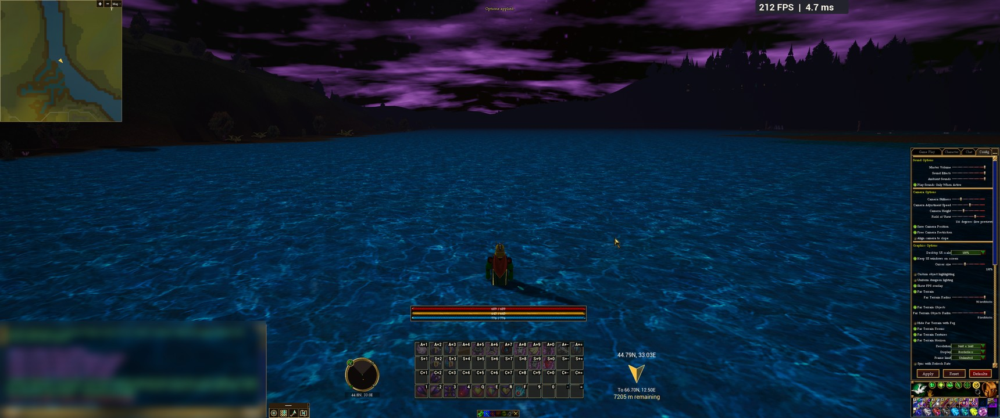](comparisons/camera-height_on.jpg) |

## Free Camera Restriction

Lets the camera zoom out to the same distance at every angle. With it off, the zoom limit depends on the camera angle, as in the client. Setting: `Free Camera Restriction`. Both pictures are zoomed out as far as the setting allows, at the same angle.

| Off | On |
|---|---|
| [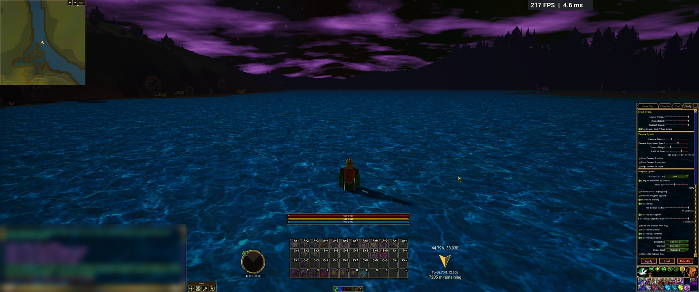](comparisons/free-camera-restriction_off.jpg) | [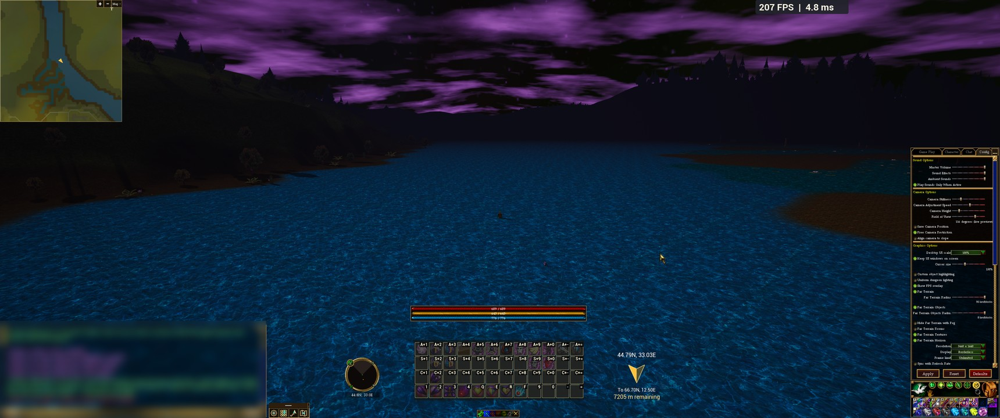](comparisons/free-camera-restriction_on.jpg) |

## Far Terrain

Draws low-detail terrain past the loaded landblocks, out to `Far Terrain Radius`, so hills and coastlines show to the horizon. Setting: `Far Terrain`.

Holtburg:

| Off | On |
|---|---|
| [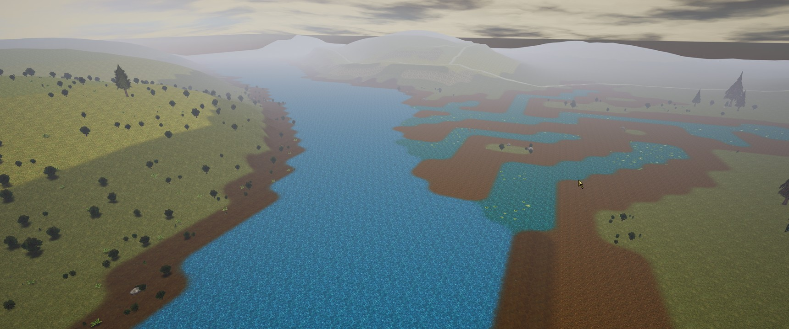](comparisons/far-terrain_holtburg_off.jpg) |  |

Mayoi:

| Off | On |
|---|---|
| [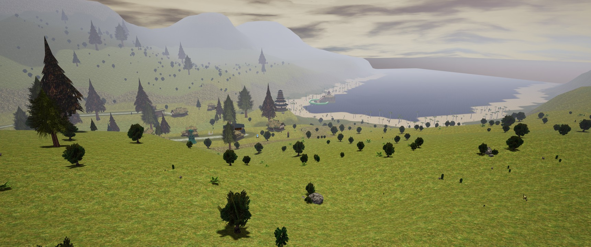](comparisons/far-terrain_mayoi_off.jpg) |  |

## Far Terrain Objects

Draws trees, rocks, buildings and other objects on the far terrain, out to `Far Terrain Objects Radius`, with simpler models further out. Setting: `Far Terrain Objects` (needs `Far Terrain`).

| Off | On |
|---|---|
| [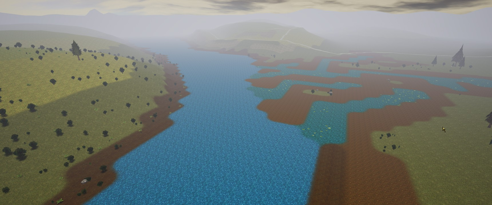](comparisons/far-terrain-objects_off.jpg) | [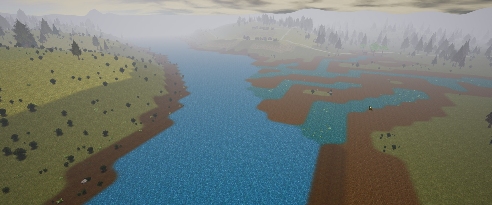](comparisons/far-terrain-objects_on.jpg) |

## Far Terrain Textures

Draws the far terrain within about 2.7 km with the same terrain textures as the loaded land, instead of flat colors. Setting: `Far Terrain Textures` (needs `Far Terrain`).

The far cliffs, both pictures cropped to the same area:

| Off | On |
|---|---|
|  |  |

## Far Terrain Horizon

Continues the night sky below eye level, so no bright strip shows between the far terrain and the sky from sunset to dawn. Setting: `Far Terrain Horizon` (needs `Far Terrain`).

| Far Terrain off | Far Terrain on, Horizon off | Far Terrain on, Horizon on |
|---|---|---|
| [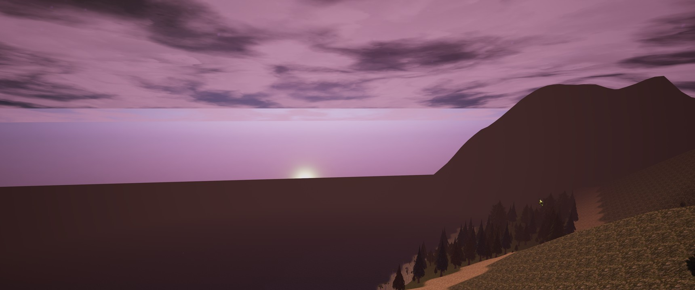](comparisons/far-terrain-horizon_far-terrain-off.jpg) |  | [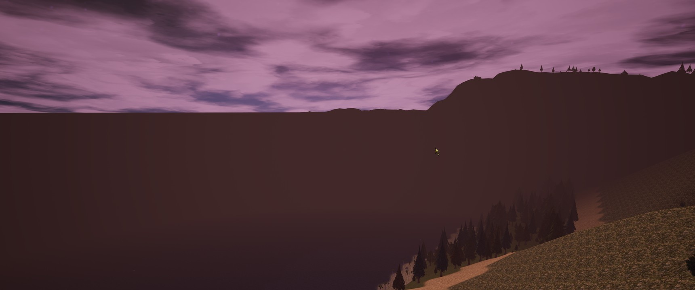](comparisons/far-terrain-horizon_on.jpg) |

## Far Terrain Rooms

Shows the rooms behind the windows and open doorways of far buildings, with their own lights at night. Doors get a dark panel until the door itself is in range. Setting: `Far Terrain Rooms` (needs `Far Terrain Objects`).

Holtburg by day:

| Off | On |
|---|---|
|  |  |

Holtburg at night, both pictures cropped to the same area around the town:

| Off | On |
|---|---|
| [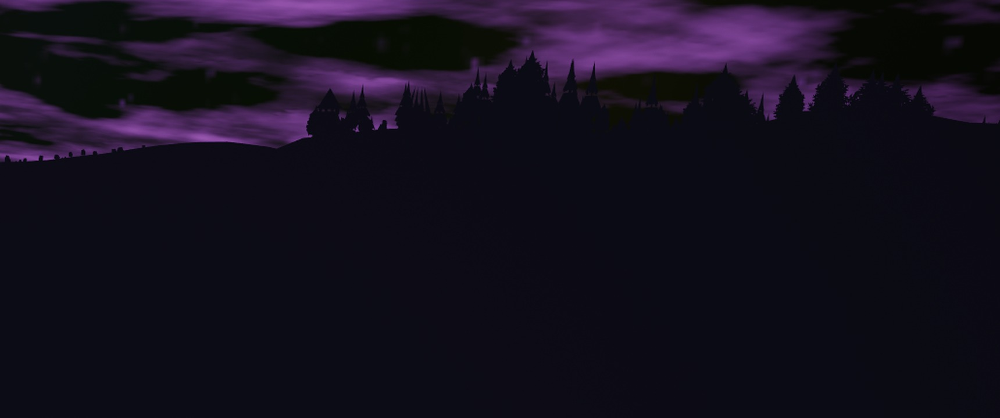](comparisons/far-terrain-rooms_night_off.jpg) | [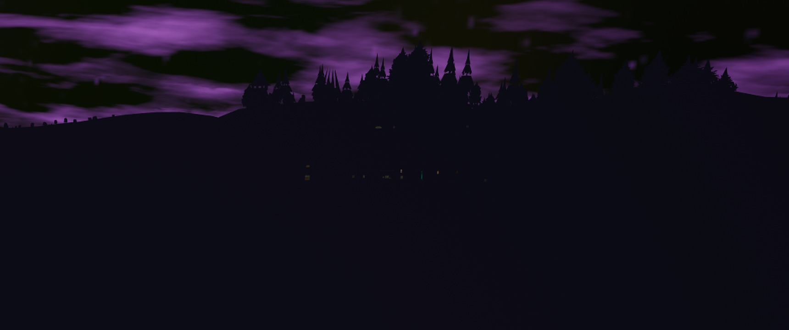](comparisons/far-terrain-rooms_night_on.jpg) |
