# Comparisons

Screenshots of each change in this fork, with its setting off and on. Each pair is from the same spot, camera and time of day. The pictures are at 3440x1440, shown at half size. Click a picture to open it.

- [v163](#v163)
  - [Fog Colors by Weather](#fog-colors-by-weather)
- [v161](#v161)
  - [All Features](#all-features)
- [v158](#v158)
  - [Camera Height](#camera-height)
  - [Free Camera Restriction](#free-camera-restriction)
  - [Far Terrain](#far-terrain)
  - [Far Terrain Objects](#far-terrain-objects)
  - [Far Terrain Textures](#far-terrain-textures)
  - [Far Terrain Horizon](#far-terrain-horizon)
  - [Far Terrain Rooms](#far-terrain-rooms)
  - [All Features](#all-features-1)

## v163

### Fog Colors by Weather

The same spot and camera in each pair, client v163 (2026.11.20.163), with the AC2 sky on: On has `Fog Colors by Weather` on at its defaults, Off has it off. Only pair 2 also changes `Far Terrain Horizon` (on in On, off in Off).

| | Off | On |
|---|---|---|
| 1. Clear, sunset | [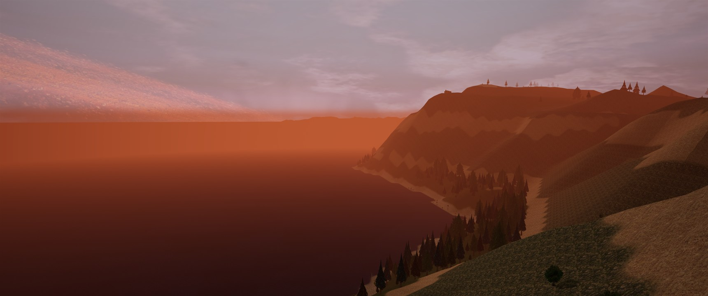](comparisons/fog-colors-v163_1_off.jpg) | [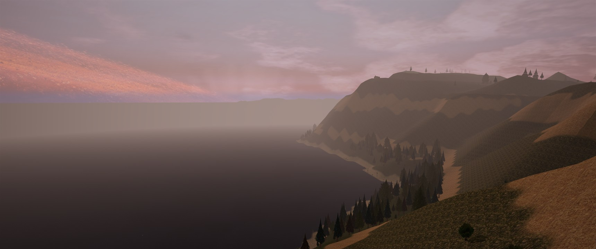](comparisons/fog-colors-v163_1_on.jpg) |
| 2. Clear, dusk, large moon up; Far Terrain Horizon also on in On, off in Off | [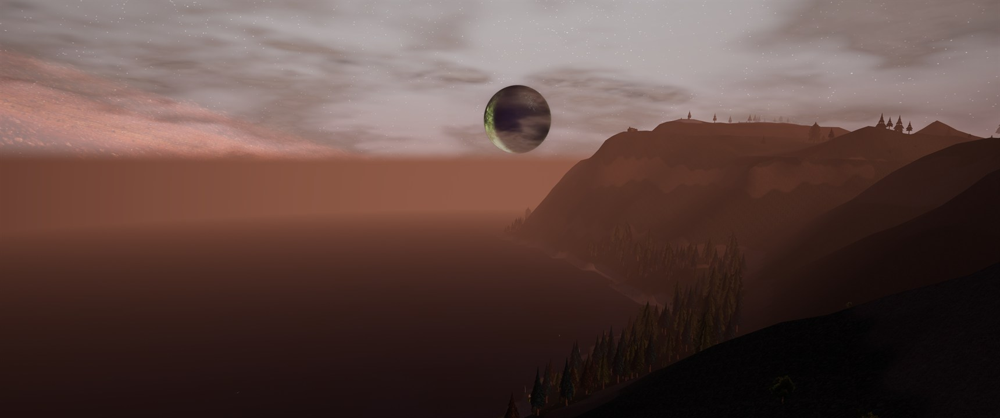](comparisons/fog-colors-v163_2_off.jpg) | [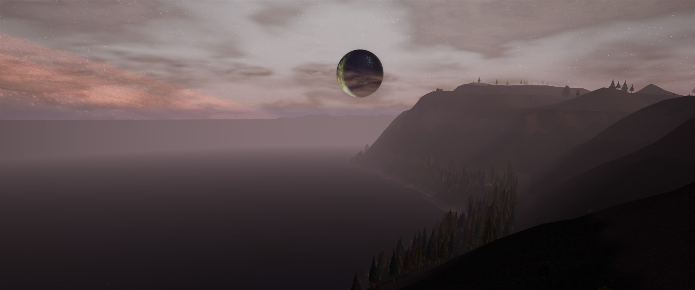](comparisons/fog-colors-v163_2_on.jpg) |
| 3. Clear, after dusk | [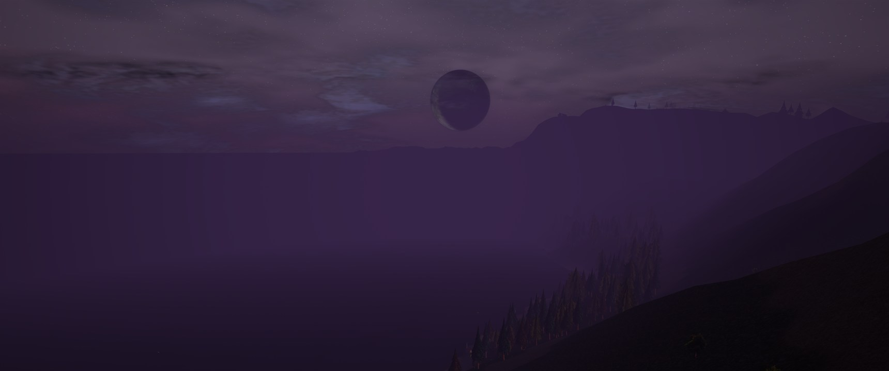](comparisons/fog-colors-v163_3_off.jpg) | [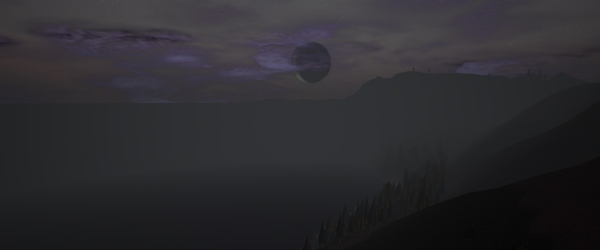](comparisons/fog-colors-v163_3_on.jpg) |
| 4. Overcast | [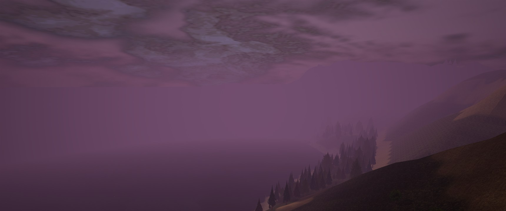](comparisons/fog-colors-v163_4_off.jpg) | [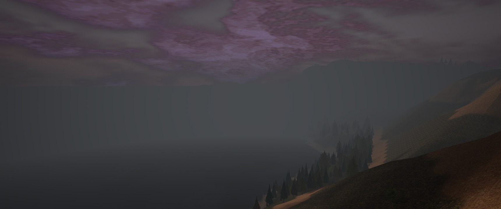](comparisons/fog-colors-v163_4_on.jpg) |
| 5. Rain | [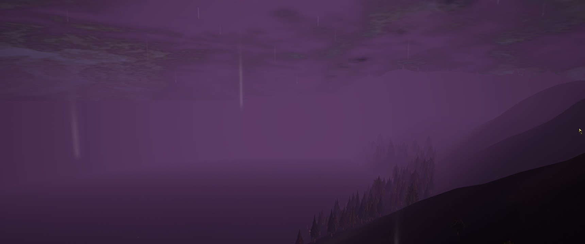](comparisons/fog-colors-v163_5_off.jpg) | [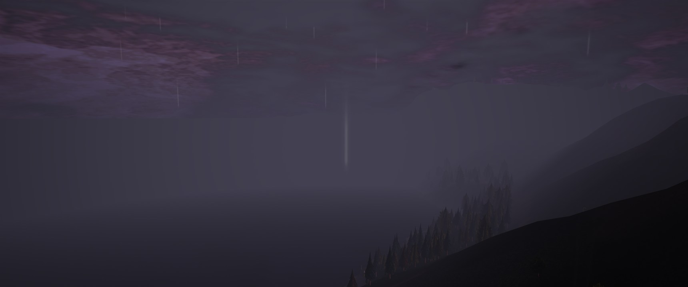](comparisons/fog-colors-v163_5_on.jpg) |
| 6. Overcast | [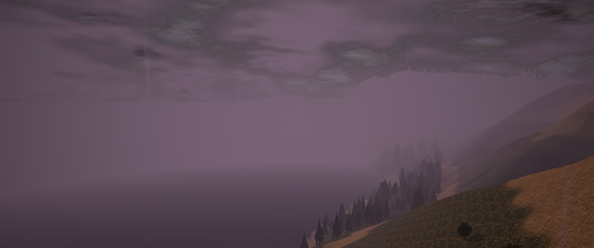](comparisons/fog-colors-v163_6_off.jpg) | [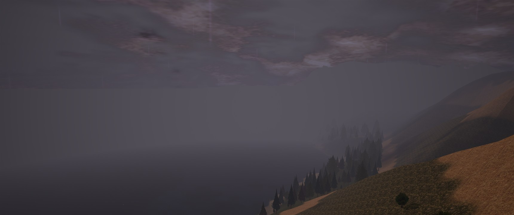](comparisons/fog-colors-v163_6_on.jpg) |

## v161

### All Features

Every feature of this fork on in both pictures, client v161 (2026.11.18.161), with `Far Terrain Horizon` on: Off is the fog without a limit and with the horizon band fully opaque, On is the fog limited to 12 landblocks (taken while testing; the default is 11), starting at 3 landblocks, at 73 % strength, with the horizon band at 73 % opacity. The chat box and two windows are blurred.

| Off | On |
|---|---|
| [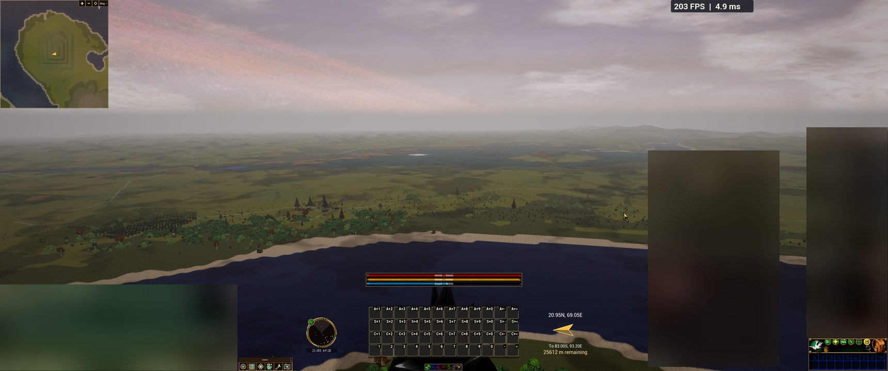](comparisons/all-features-v161_1_off.jpg) | [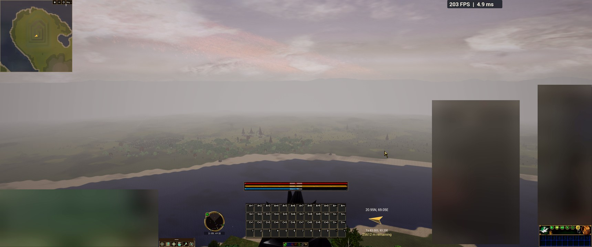](comparisons/all-features-v161_1_on.jpg) |

## v158

Client v158 (2026.11.15.158), the features as sent in pull request #1.

### Camera Height

Raises the point the third person camera turns around, so the view looks over the character. Setting: `Camera Height` (1.5 to 5; 1.5 is the client's height). Both pictures are at the same zoom.

| Default (1.5) | Raised |
|---|---|
| [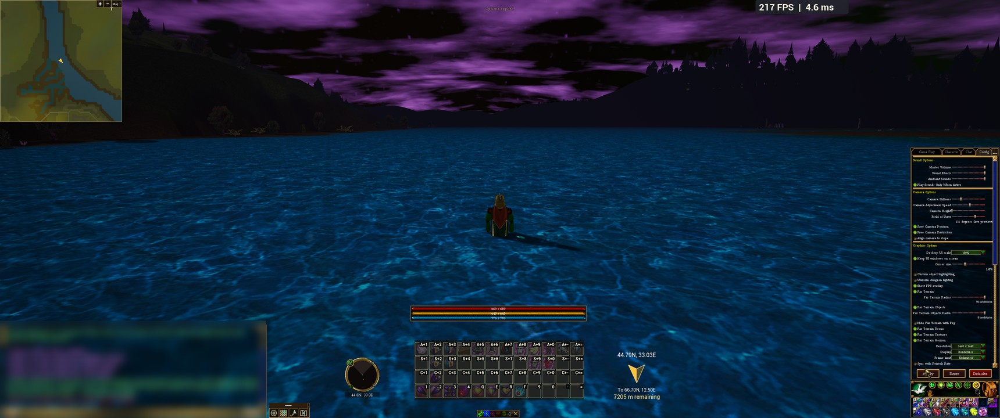](comparisons/camera-height_off.jpg) |  |

### Free Camera Restriction

Lets the camera zoom out to the same distance at every angle. With it off, the zoom limit depends on the camera angle, and can only be zoomed out far if the camera is positioned directly above the character (retail). Setting: `Free Camera Restriction`. The first picture shows retail zoom distance restriction, the second shows it with the setting enabled.

| Off | On |
|---|---|
|  |  |

### Far Terrain

Draws low-detail terrain past the loaded landblocks, out to `Far Terrain Radius`, so hills and coastlines show to the horizon. Setting: `Far Terrain`.

Holtburg:

| Off | On |
|---|---|
|  |  |

Mayoi:

| Off | On |
|---|---|
|  |  |

### Far Terrain Objects

Draws trees, rocks, buildings and other objects on the far terrain, out to `Far Terrain Objects Radius`, with simpler models further out. Setting: `Far Terrain Objects` (needs `Far Terrain`).

| Off | On |
|---|---|
|  |  |

### Far Terrain Textures

Draws the far terrain within about 2.7 km with the same terrain textures as the loaded land, instead of flat colors. Setting: `Far Terrain Textures` (needs `Far Terrain`).

The far cliffs, both pictures cropped to the same area:

| Off | On |
|---|---|
| [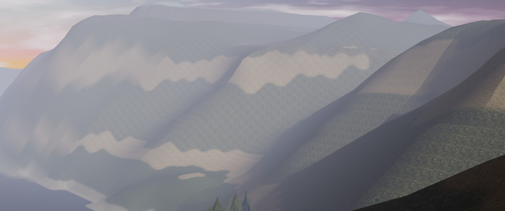](comparisons/far-terrain-textures_detail_off.jpg) | [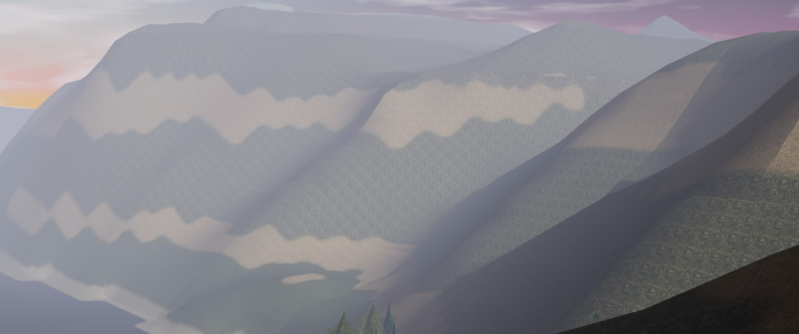](comparisons/far-terrain-textures_detail_on.jpg) |

### Far Terrain Horizon

Continues the night sky below eye level, so no bright strip shows between the far terrain and the sky from sunset to dawn. Setting: `Far Terrain Horizon` (needs `Far Terrain`).

| Far Terrain off | Far Terrain on, Horizon off | Far Terrain on, Horizon on |
|---|---|---|
|  |  |  |

### Far Terrain Rooms

Shows the rooms behind the windows and open doorways of far buildings, with their own lights at night. Doors get a dark panel until the door itself is in range. Setting: `Far Terrain Rooms` (needs `Far Terrain Objects`).

Holtburg by day:

| Off | On |
|---|---|
| [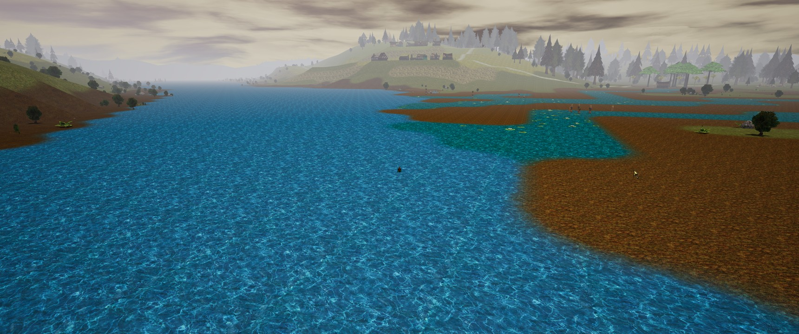](comparisons/far-terrain-rooms_day_off.jpg) |  |

Holtburg at night, both pictures cropped to the same area around the town:

| Off | On |
|---|---|
|  |  |

### All Features

Every feature of this fork off, and every feature on, at eight places. The other sections show one feature at a time.

| Off | On |
|---|---|
| [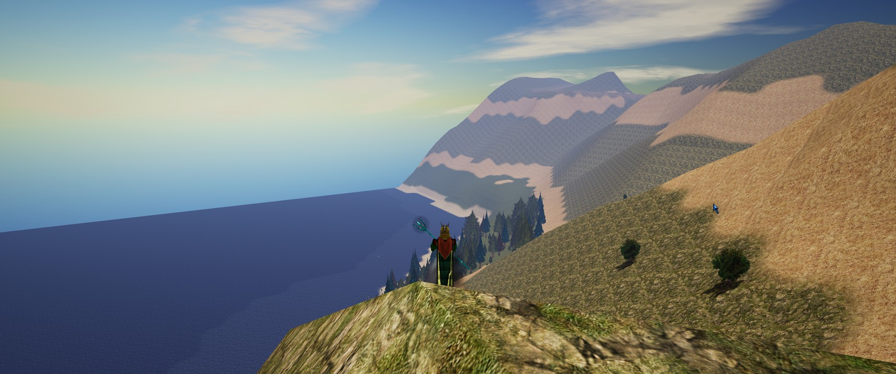](comparisons/all-features_1_off.jpg) | [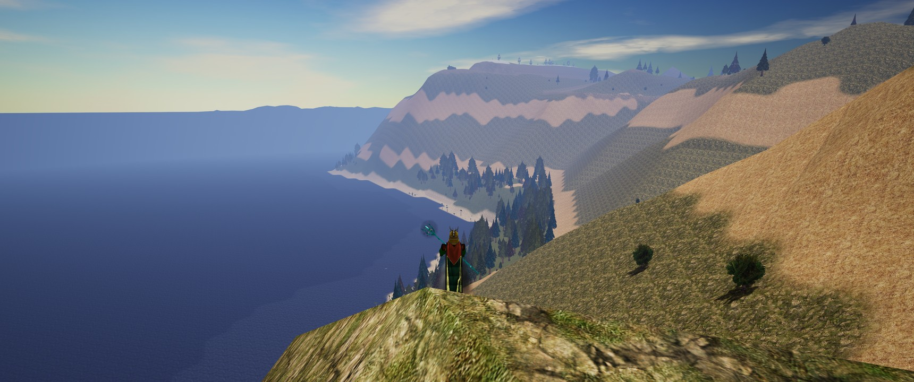](comparisons/all-features_1_on.jpg) |
| [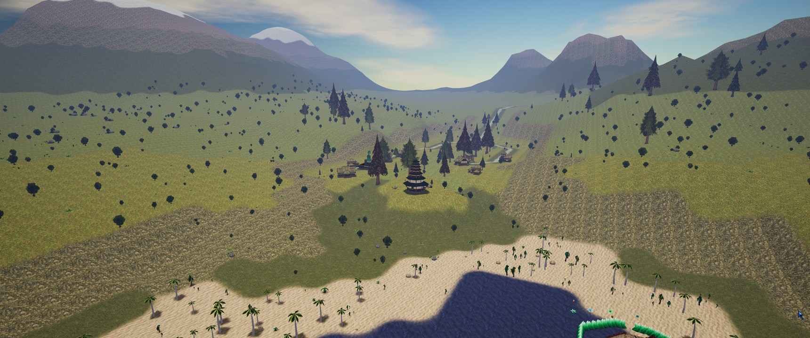](comparisons/all-features_2_off.jpg) | [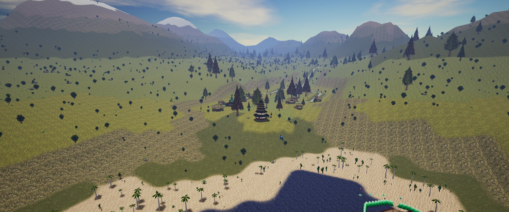](comparisons/all-features_2_on.jpg) |
| [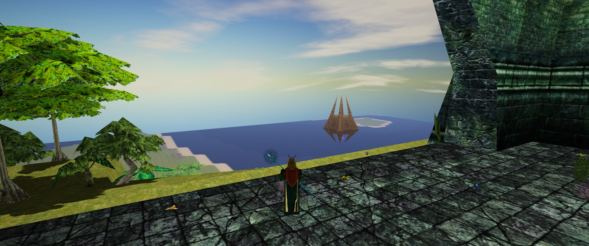](comparisons/all-features_3_off.jpg) | [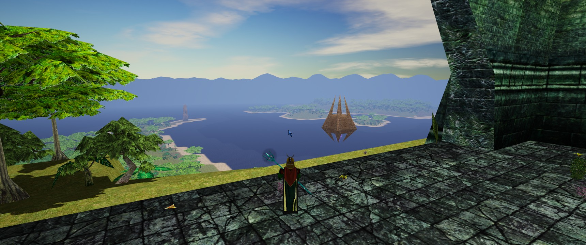](comparisons/all-features_3_on.jpg) |
| [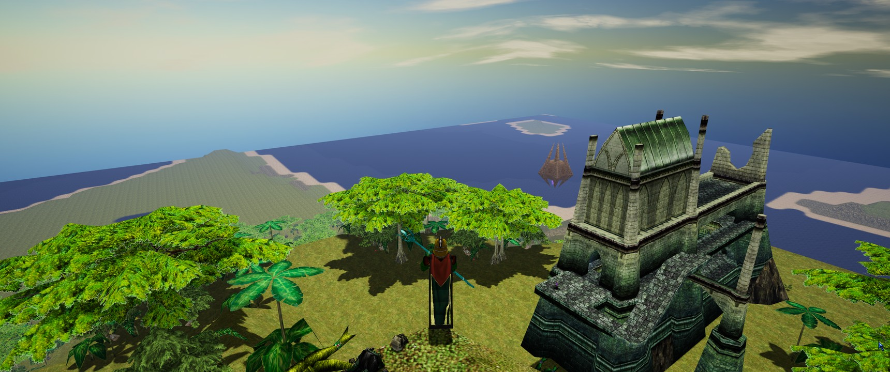](comparisons/all-features_4_off.jpg) | [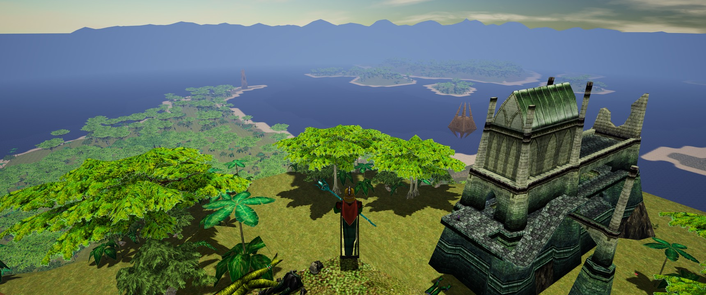](comparisons/all-features_4_on.jpg) |
| [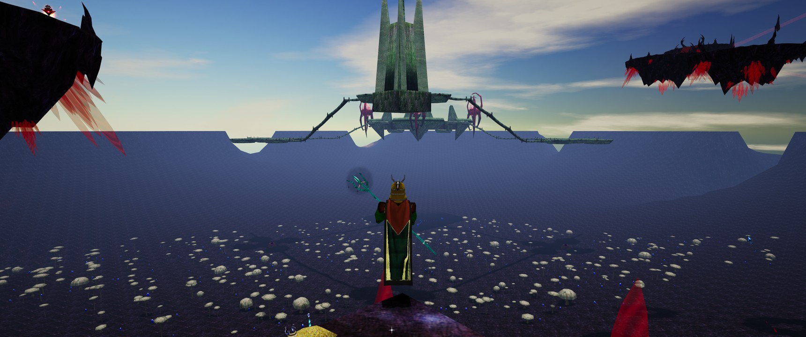](comparisons/all-features_5_off.jpg) | [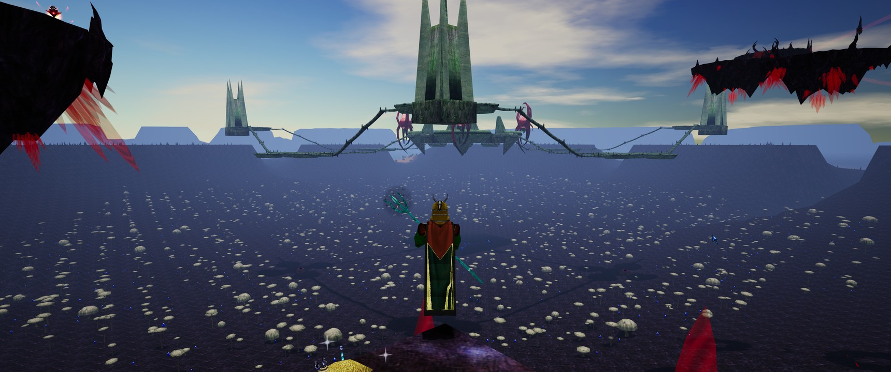](comparisons/all-features_5_on.jpg) |
| [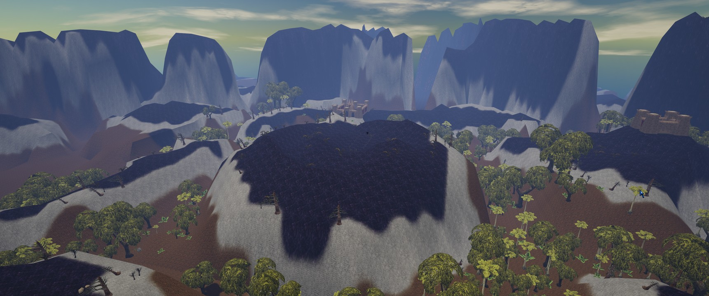](comparisons/all-features_6_off.jpg) | [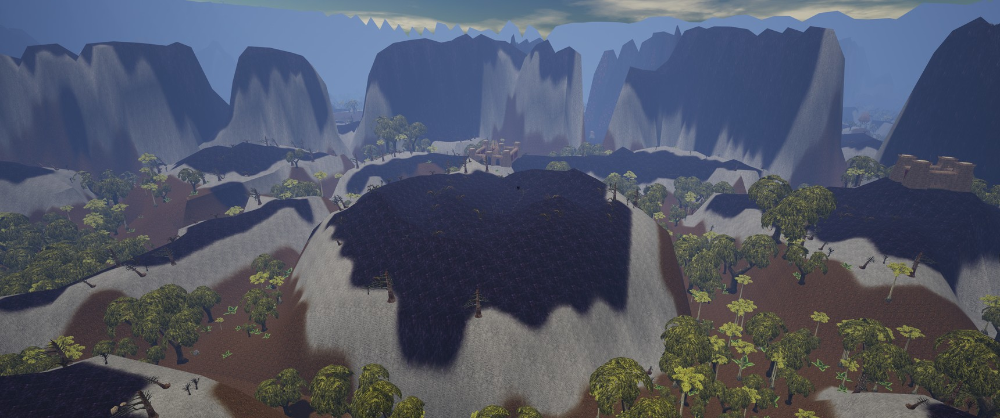](comparisons/all-features_6_on.jpg) |
| [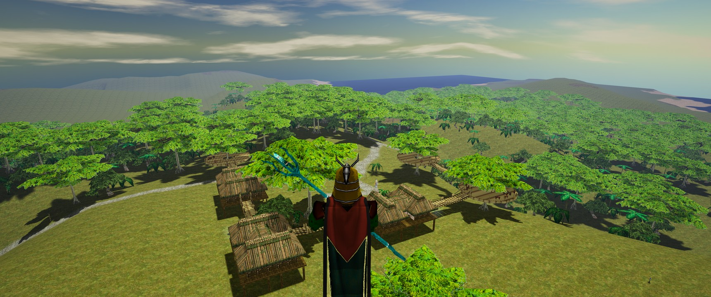](comparisons/all-features_7_off.jpg) | [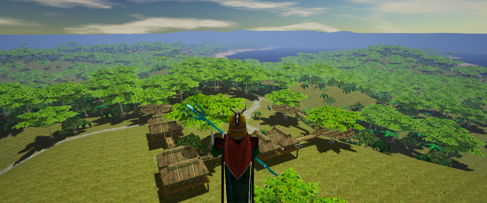](comparisons/all-features_7_on.jpg) |
| [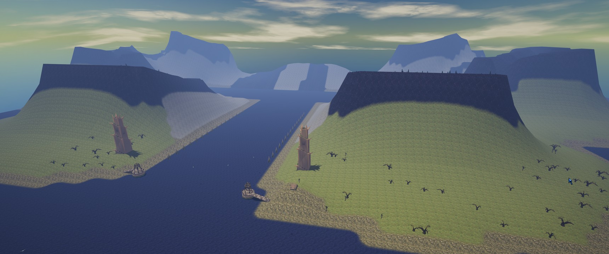](comparisons/all-features_8_off.jpg) | [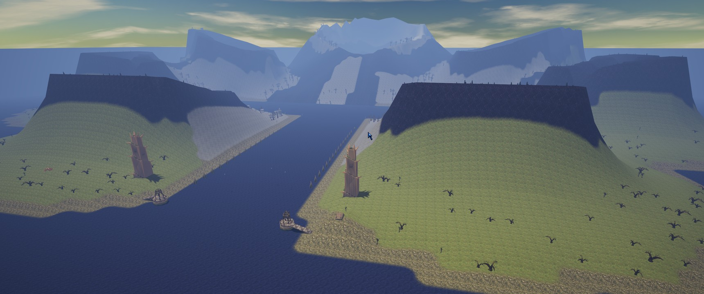](comparisons/all-features_8_on.jpg) |
